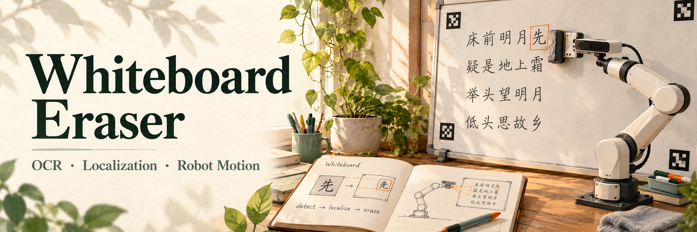
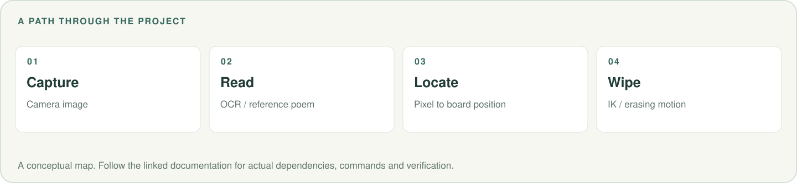

# Whiteboard Eraser · RM65



[](LICENSE)

[](https://oye-li-bc.github.io/)

RM65 机械臂在 Gazebo 仿真中，用 **PaddleOCR** 识别白板上的古诗，与标准诗句比对找出**错别字**，
控制机械臂只擦掉那一个错字，并在原位盖一块白色补丁使其"消失"。

> 📌 **真机版(RM65 + D435 眼在手上)见 [`README_REAL.md`](README_REAL.md)** —— 手眼标定、ArUco 平面、
> 原生 movej 运动、贴板来回擦,含最终跑通参数与踩坑记录。本文件只讲 Gazebo 仿真。

---

**[功能流程](#workflow) · [环境依赖](#environment) · [运行](#run) · [真机版本](README_REAL.md) · [问题排查](#troubleshooting)**

<picture>
  <source media="(max-width: 600px)" srcset=".github/readme/workflow-mobile.svg">
  
</picture>

<a id="workflow"></a>

## 1. 功能流程

```
启动 → 随机选一首诗 + 制造一个错别字 → 渲染成白板贴图(PNG)
     ↓
相机拍白板 → PaddleOCR 识别每行文字 → 与标准诗句逐字比对 → 定位错字
     ↓
反投影出错字世界坐标 → IK + 笛卡尔弓字形轨迹擦拭 → 原位 spawn 白色补丁覆盖
```

- **识别是真 OCR**：从相机图像识别文字，不是读答案文件。
- **判对错需要参照**：标准诗句由 `poem_layout.yaml` 提供（`gen_poem_texture` 生成），
  错字位置靠"OCR 结果 vs 标准诗句"的差异算出，不是直接读答案。

---

<a id="environment"></a>

## 2. 依赖环境

- Ubuntu 22.04 + ROS 2 Humble + Gazebo 11 + MoveIt2 + ros2_control
- 依赖功能包：`rm_description` / `rm_gazebo` / `rm_65_config`（睿尔曼官方 RM65 包）
- Python 依赖（CPU 即可）：

```bash
# 中文字体（渲染诗句贴图必需）
sudo apt install -y fonts-noto-cjk

# PaddleOCR（本机验证可用版本；paddleocr 首装若 wheel 损坏，加 --no-cache-dir 重装）
pip install -i https://pypi.tuna.tsinghua.edu.cn/simple paddlepaddle==3.3.1
pip install --no-cache-dir -i https://pypi.tuna.tsinghua.edu.cn/simple paddleocr==3.7.0

# 其它
pip install opencv-python pillow pyyaml
```

> **PaddleOCR 关键坑（务必知道）**
> 1. 默认会拉 **PP-OCRv6** 模型，镜像上没有 → 段错误。代码已强制 `ocr_version='PP-OCRv5'`。
> 2. paddle 3.3.1 的 oneDNN 执行器有 bug（`ConvertPirAttribute2RuntimeAttribute`）→ 代码已强制 `enable_mkldnn=False`。
> 3. 首次运行会联网下载 PP-OCRv5 模型到 `~/.paddlex/`，需能访问 modelscope。

---

<a id="build"></a>

## 3. 编译

```bash
cd ~/ros2_ws
colcon build --packages-select whiteboard_eraser
source install/setup.bash
```

> 不要用 `--symlink-install`（对本包的 materials 嵌套 data_files 会报错），用普通 `colcon build`。

---

<a id="run"></a>

## 4. 运行

```bash
# 每次启动前先清掉残留 gazebo（否则端口 11345 被占，世界起不来）
pkill -9 -f gzserver; pkill -9 -f gzclient; pkill -9 -f gazebo

source ~/ros2_ws/install/setup.bash
ros2 launch whiteboard_eraser wipe_demo.launch.py
```

启动后：
- Gazebo 里出现白板（贴着一首诗，其中一个字是错的）+ RM65 机械臂。
- 终端 `detect_text_node` 会打印：`OCR 识别: [...]` 和 `发现 N 个错别字`。
- 机械臂移动到错字处，弓字形擦拭，然后盖白补丁。

调试图：
- `/tmp/whiteboard_view.png` —— 相机实际拍到的画面。
- `/tmp/whiteboard_detect.png` —— 识别到的错字用红框标出。

---

## 5. 关键参数（`config/scene.yaml`）

| 字段 | 含义 |
|------|------|
| `board.Xb` | 白板前表面 x（擦头接触面） |
| `board.width_y / height_z` | 板宽/板高，决定贴图分辨率与字距 |
| `camera.*` | 相机位姿与视场，用于反投影 |
| `eraser.length` | 擦头沿工具轴凸出长度 |
| `eraser.half` | 擦头面半宽（弓字形行距 = 2×half） |
| `eraser.press` | 压入板面深度 |

换诗 / 指定错字（默认随机）：单独跑生成脚本

```bash
ros2 run whiteboard_eraser gen_poem_texture \
  --scene <scene.yaml> --out-dir <pkg目录> --layout /tmp/poem_layout.yaml \
  --index 0 --seed 3            # 或 --lines "床前明月光" "疑是地上霜" ...
```

---

## 6. 代码结构

| 文件 | 职责 |
|------|------|
| `poems.py` | 内置诗库 + 形近/音近混淆表 + `make_typo` 制造错字 + `compare_lines` 逐字比对 |
| `gen_poem_texture.py` | 渲染诗句贴图(行内字距紧凑、行间距拉大，OCR 才按行识别) + 写 `poem_layout.yaml` |
| `detect_text_node.py` | PaddleOCR 识别 → 比对 → 行框按字数均分定位错字 → 反投影 → 发布 `/wipe_targets` |
| `geometry_utils.py` | 像素反投影、擦头姿态四元数、弓字形覆盖路径 |
| `wipe_node.py` | 订阅错字目标 → IK/笛卡尔轨迹擦拭 → gazebo `/spawn_entity` 贴白补丁 |
| `wipe_demo.launch.py` | 总启动：生成贴图 + 拉起 Gazebo/MoveIt + 视觉/擦拭节点 |

---

<a id="troubleshooting"></a>

## 7. 已知坑排查

| 现象 | 原因 / 解决 |
|------|-------------|
| gazebo 打不开 / 一直空的 | 有残留 gazebo 占用端口 11345 → 先 `pkill -9 -f gazebo` |
| `Could not open worlds/empty.world` / `Unable to find shader lib` | `GAZEBO_RESOURCE_PATH` 被覆盖 → 已在 launch 中保留系统路径并只追加本包 models 目录 |
| OCR 段错误 / 模型 404 | 见第 2 节 PaddleOCR 三个坑 |
| OCR 把一列字读成一行 | 贴图行距要 > 列距（已在 gen_poem_texture 处理） |
| 擦拭范围太大糊到邻字 | 调小 `eraser`（URDF box 尺寸 + `scene.yaml half`）、detect 的字格取值比例、白补丁封顶 |
| 白板上诗句是镜像/倒的 | Gazebo box 面 UV 问题 → 需在 `gen_poem_texture.render` 加水平/垂直翻转（如遇到再加开关） |

---

[个人作品集](https://oye-li-bc.github.io/) · [封面来源与配图说明](.github/readme/README.md)
